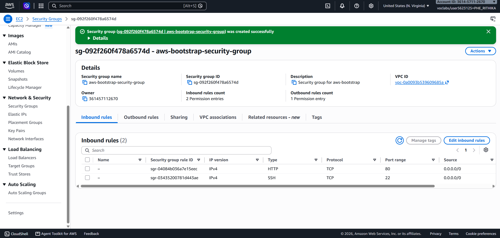
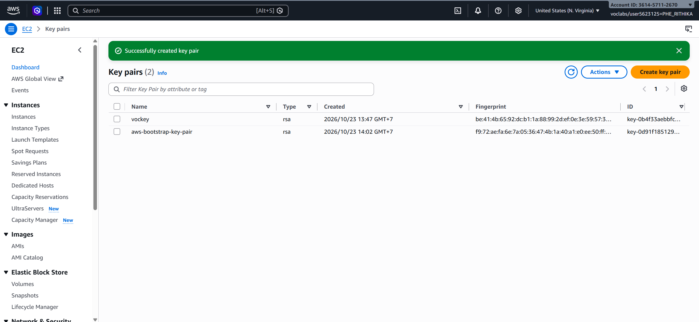
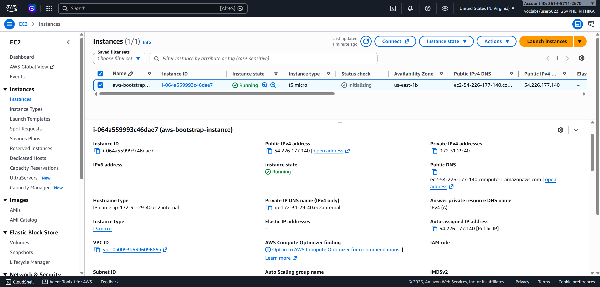
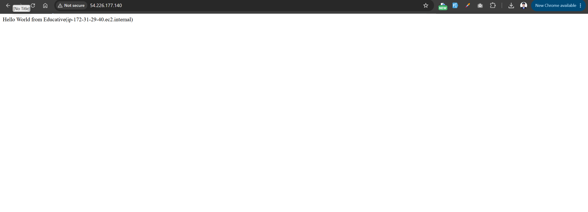
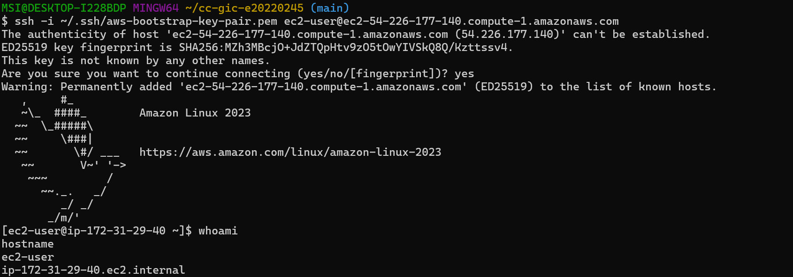
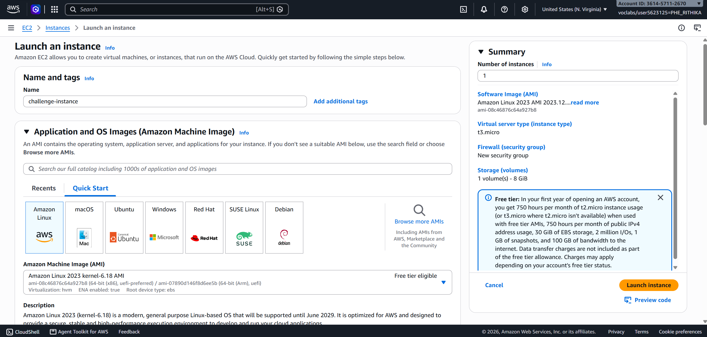
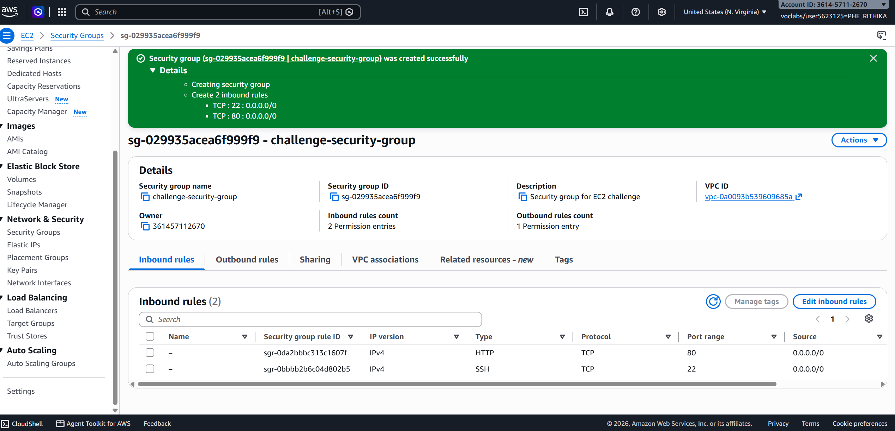
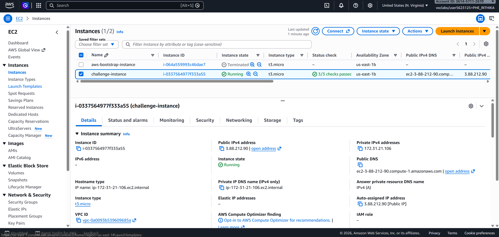
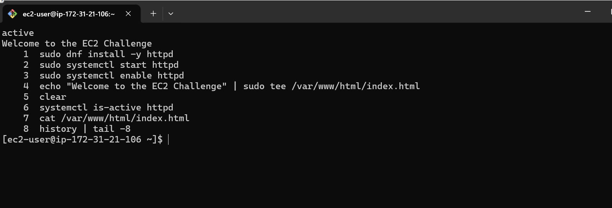
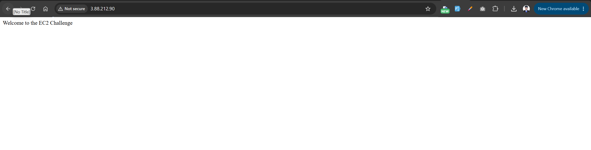

# Lab 1: Amazon EC2

Student ID: e20220245
Name: Phe Rithika
Region: US East (N. Virginia) us-east-1

## Part 1.1: EC2 Walkthrough

### Task 1: Security group
I created `aws-bootstrap-security-group` in the default VPC. It allows SSH (22) and HTTP (80) from Anywhere-IPv4.



### Task 2: Key pair
I created the RSA key pair `aws-bootstrap-key-pair` in .pem format. I kept the private key in `~/.ssh`, outside the repository.



### Task 3: Launch the instance
I launched `aws-bootstrap-instance` with Amazon Linux 2023 (x86), 8 GiB gp3 storage, and the security group and key pair above. A user data script installed and started Apache and created the Hello World page. The lab asks for t2.micro, but I used t3.micro because it was the free tier eligible type in my account.



### Task 4: Test the instance
Browser test over HTTP:



SSH test from Git Bash on my own computer (`ssh -i ~/.ssh/aws-bootstrap-key-pair.pem ec2-user@<public DNS>`). `whoami` returned `ec2-user`.



### Clean up
I terminated the instance, deleted the key pair, and deleted the security group.

## Part 1.2: Challenge

### Configuration
- Instance: `challenge-instance`, Amazon Linux 2023, t3.micro (used instead of t2.micro, same reason as above), with a public IP
- Security group: `challenge-security-group` allowing HTTP (80) and SSH (22)
- Root volume: 10 GiB gp3
- Web server: Apache (httpd), installed by hand over SSH







### Commands I ran on the instance
```bash
sudo dnf install -y httpd
sudo systemctl start httpd
sudo systemctl enable httpd
echo "Welcome to the EC2 Challenge" | sudo tee /var/www/html/index.html
systemctl is-active httpd
cat /var/www/html/index.html
```



### Result
The page loaded from the public IP at `http://3.88.212.90`.



### Clean up
I terminated `challenge-instance`, deleted `challenge-key-pair`, and deleted `challenge-security-group`.
