# Cloud Lab 2: Attach an Application Load Balancer to an EC2 Auto Scaling Group

| Item | Details |
|---|---|
| Student | Phe Rithika |
| Region | US East (N. Virginia) `us-east-1` |
| Services | Elastic Load Balancing (ALB), EC2 Auto Scaling, EC2 |

## Summary

I built a load-balanced web tier: two security groups, a target group, an internet-facing Application Load Balancer, a launch template, and an Auto Scaling group (desired 2, min 2, max 3) attached to the target group. I then tested load balancing in the browser, stopped the web server on one instance, and watched the instance get marked unhealthy and replaced. All resources were deleted at the end.

## Concepts

- **Load balancer:** the single entry point for clients. It receives a request, evaluates its listener rules, picks a healthy registered target and forwards the request.
- **Target group:** the logical group of instances (targets) that receive the traffic. It also runs the health checks.
- **Health check:** a periodic request (here `GET /` over HTTP every 30 s). A response other than 200 is a failure. After 2 failed checks in a row the target is *unhealthy* and traffic stops going to it.

## Task 1: Security groups

| Group | Inbound rules |
|---|---|
| `LoadBalancerSecurityGroup` | HTTP (80) from `0.0.0.0/0` |
| `LaunchTemplateSecurityGroup` | HTTP (80) and SSH (22) from `0.0.0.0/0` |

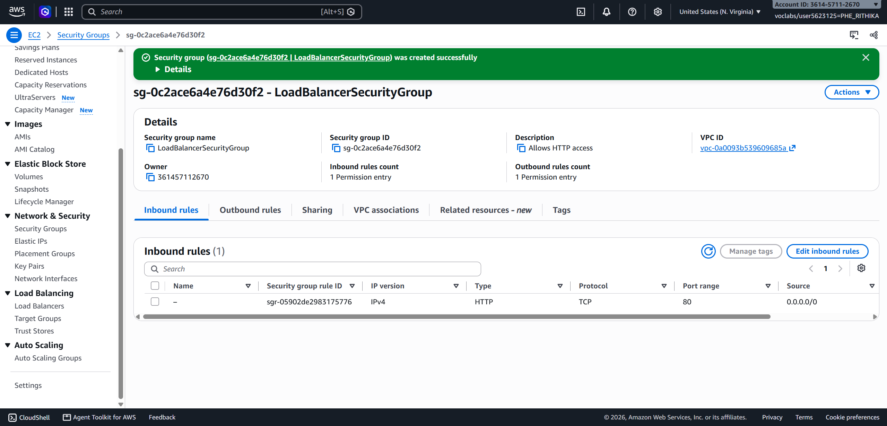
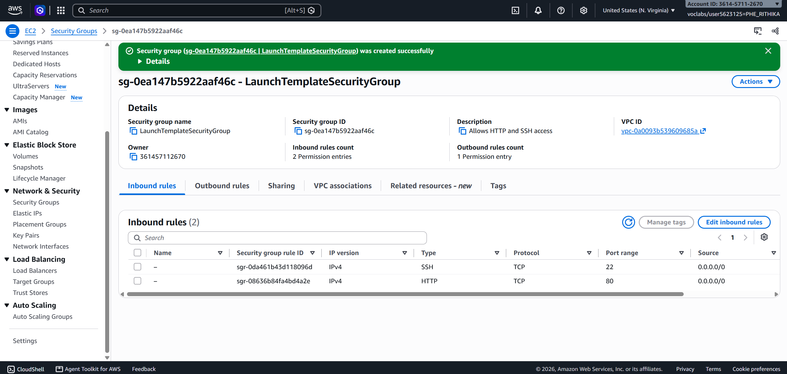

## Task 2: Target group

`LoadBalancerTargetGroup`: target type Instance, HTTP, port 80, default VPC. Health check settings kept at defaults: protocol HTTP, path `/`, interval 30 s, timeout 5 s, healthy threshold 5, unhealthy threshold 2, success code 200.

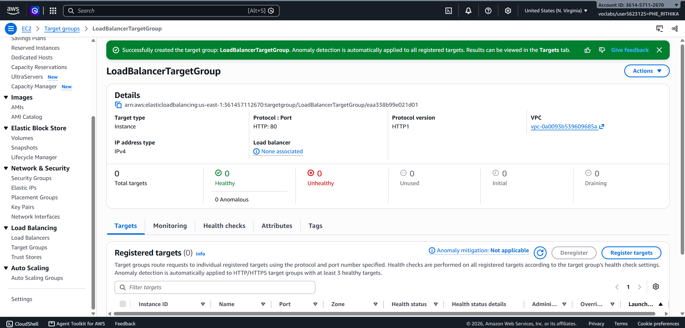
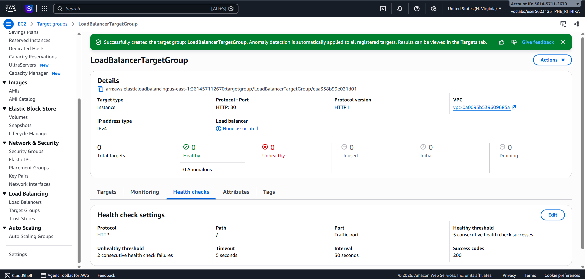

## Task 3: Application Load Balancer

`MyLoadBalancer`: Application type, Internet-facing, IPv4, default VPC, mapped to all Availability Zones (6 in this account), security group `LoadBalancerSecurityGroup`, listener HTTP:80 forwarding to `LoadBalancerTargetGroup`.

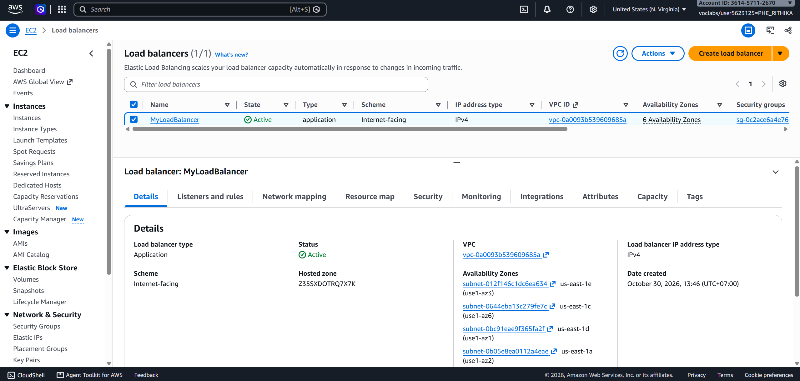
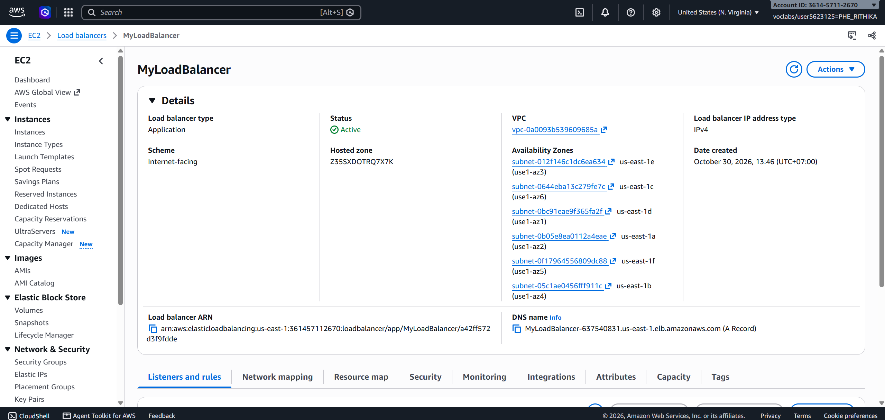

## Task 4: Launch template and Auto Scaling group

- `AutoScalingLaunchTemplate`: Amazon Linux 2023, `t2.micro`, `LaunchTemplateSecurityGroup`, user data installs and starts `httpd` and writes `Hello World from ($(hostname))` to `index.html`.
- `MyAutoScalingGroup`: uses the launch template, all zones, attached to `LoadBalancerTargetGroup`, ELB health checks on, desired 2 / min 2 / max 3.

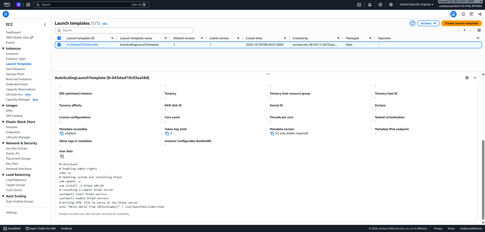
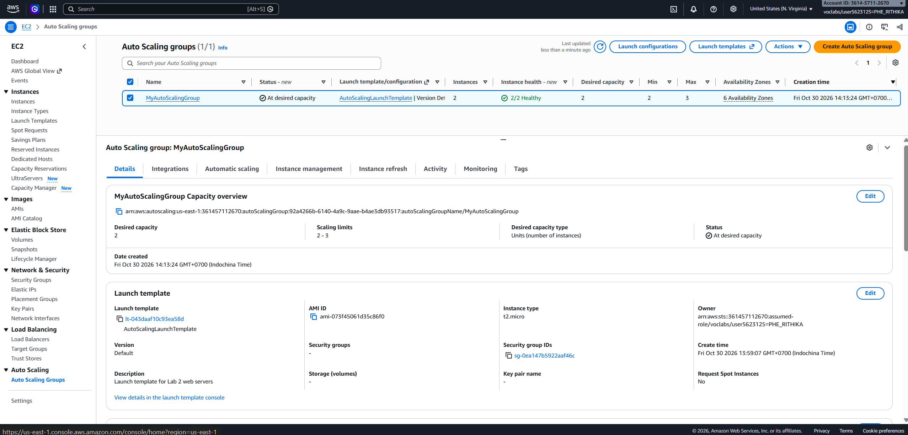
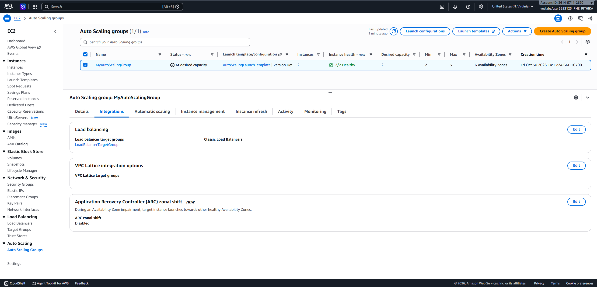

## Task 5: Testing

### Load balancing

Opening the load balancer's DNS name returned the host name of the instance that served the request. The first request was served by `ip-172-31-61-184`; a later request was served by `ip-172-31-13-130`.

My browser kept reusing one connection to the first instance, so plain refreshes always showed the same host name. I added a query string (`/?a=3`) to force a new request, which was then served by the other instance. I also opened each instance's public IP directly to confirm both web servers were working.

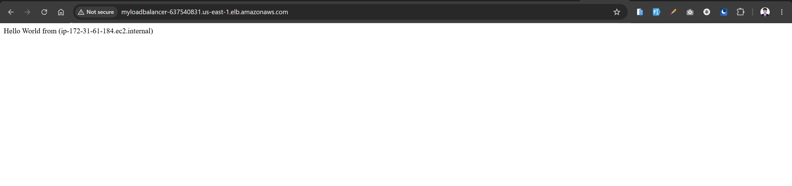
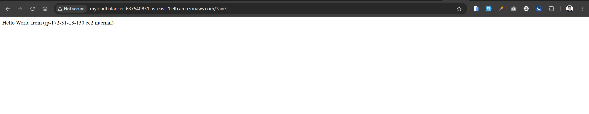

### Simulated failure

I connected to an instance with EC2 Instance Connect and ran `sudo systemctl stop httpd.service`. The instance kept running, but its web server stopped answering. The target group's health checks failed, the target went to *Unhealthy / Draining* and was deregistered, and the Auto Scaling group launched a replacement, which became *Healthy*. The target group returned to 2 healthy targets.

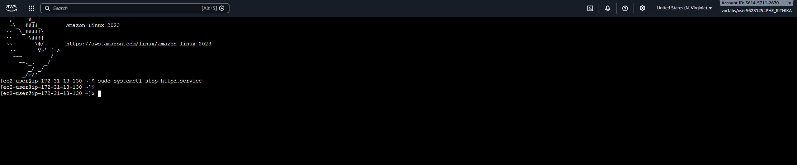
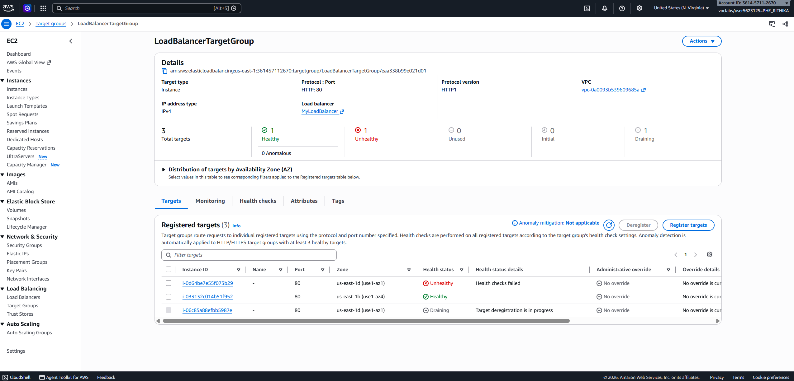
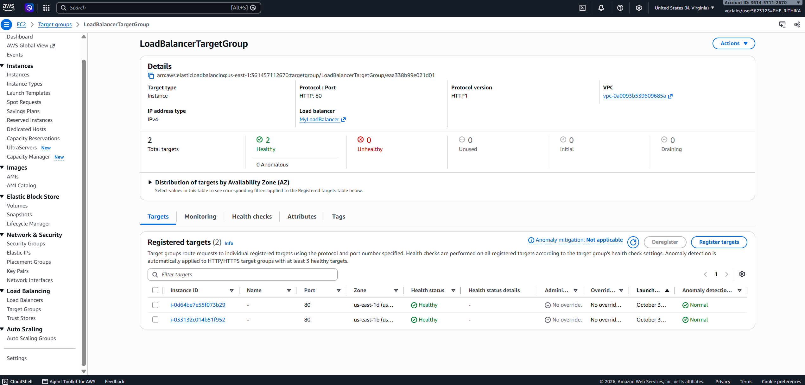

## Problems and observations

1. **Targets showed "Unused" / no load balancer associated.** The listener's default action was *Return fixed response (503)* instead of forwarding to the target group. After changing the default action to *Forward to target groups* and selecting `LoadBalancerTargetGroup`, both targets became Healthy.
2. **Accidental termination.** I terminated one instance by mistake instead of connecting to it. The Auto Scaling group launched a replacement automatically to keep the desired capacity at 2. A terminated instance cannot be recovered, and it does not need to be.
3. **Replacement instance briefly unhealthy.** A newly launched instance failed its first health checks while its user data (`yum update`, installing `httpd`) was still running, then became Healthy.
4. **Health check thresholds.** The console defaults were healthy threshold 5 and unhealthy threshold 2 (two failed checks mark a target unhealthy, as the lab describes).

## Clean-up

Deleted in reverse order of creation: Auto Scaling group, launch template, load balancer, target group, and both security groups.

