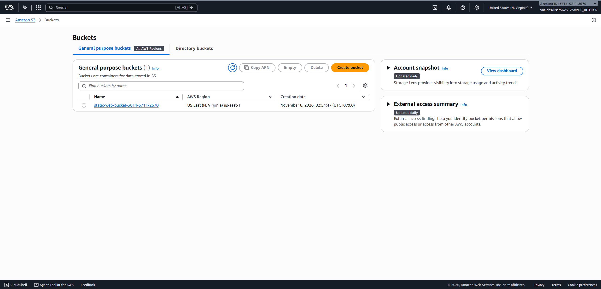
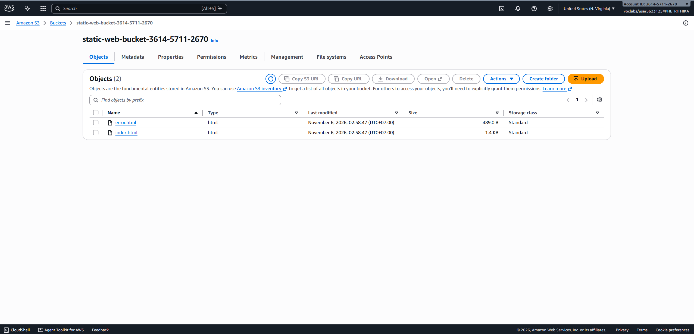
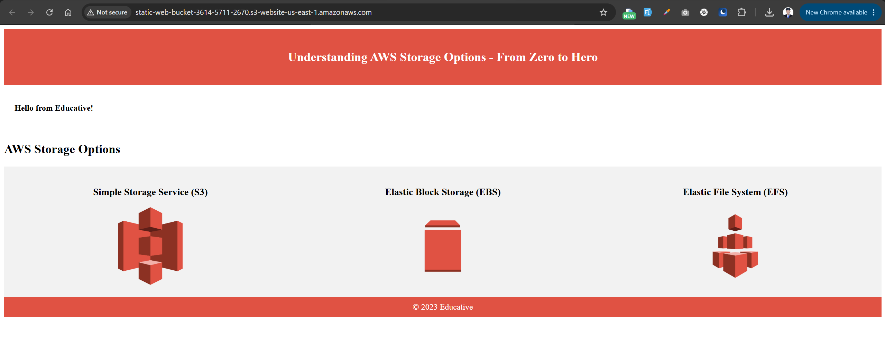
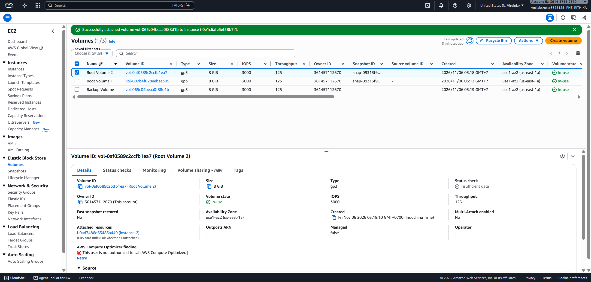
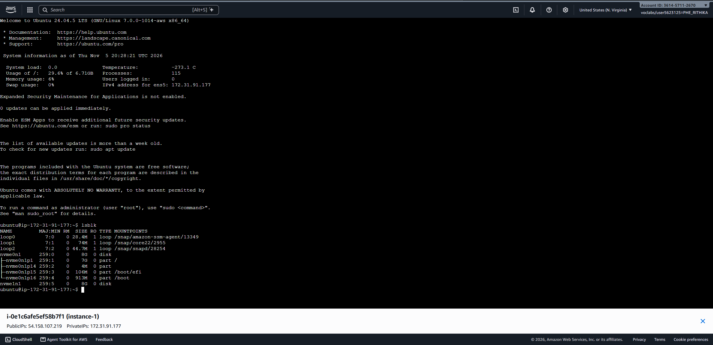
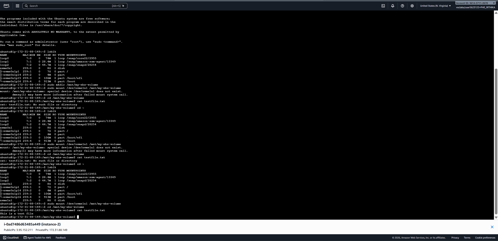
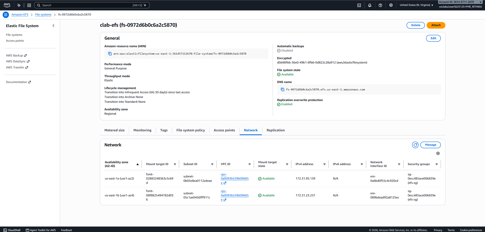
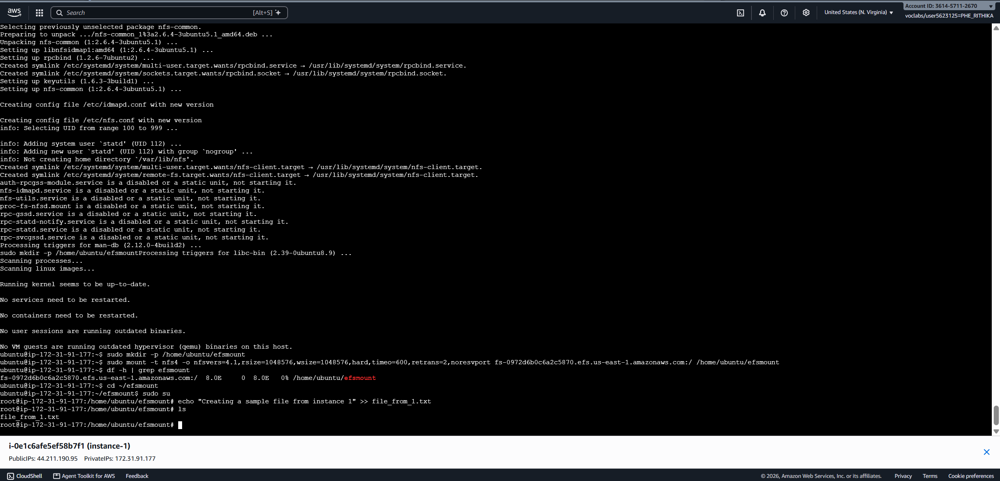
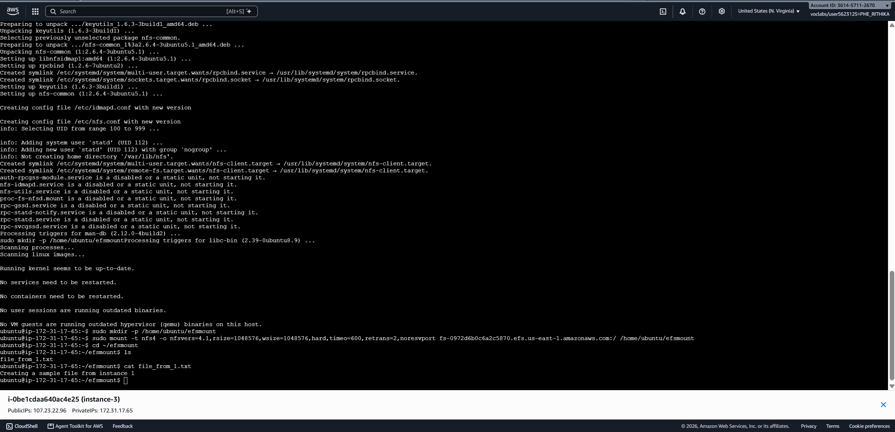

# Cloud Lab 3 Submission — AWS Storage Options

- **Student name:** Phe Rithika
- **Student ID:** e20220245
- **Learner Lab user name:** voclabs/user5623125=PHE_RITHIKA
- **Date completed:** 2026-11-06

---

## Part 2.1 — Amazon S3

### Bucket list

### Uploaded files

### Static website

---

## Part 2.2 — Amazon EBS

### Volumes page

### Attached volume (`lsblk`)

Which device name did your volume get (`xvdf`, `nvme1n1`, ...)? **`nvme1n1`** (the root volume was `nvme0n1`).

### File read on instance-2

---

## Part 2.3 — Amazon EFS

### File system and mount targets

### File created on instance-1

### File listed on instance-3

---

## Questions

1. **403 Forbidden, and what changed?** Turning off Block Public Access only removes the safety lock; it does not grant anyone permission. With no policy allowing access, S3 denies anonymous requests, so the website endpoint returned 403. After I added a bucket policy that allows `s3:GetObject` for principal `*` on every object in the bucket, anyone could read the objects, and the endpoint served `index.html`.

2. **Root volume of instance-1 after termination:** the root volume is deleted when its instance is terminated, so a file saved there would be lost. Backup Volume is a separate volume that persists independently of the instance, which is why `testfile.txt` survived the move.

3. **Why `mkfs` on instance-1 but not instance-2:** the new volume was blank, with no file system, so it had to be formatted with ext4 once before use. On instance-2 the volume already held a file system and my data; running `mkfs` again would have erased it, so I only mounted it.

4. **EFS vs EBS sharing, and mount-target subnets:** EBS is block storage that behaves like one disk attached to one instance at a time, so it had to be detached before attaching elsewhere. EFS is a network file system (NFS) designed for parallel access, with file locking to keep data consistent, so many instances can mount it at the same time. Instances reach EFS through a mount target, which gives an NFS endpoint IP address in one Availability Zone. Each instance connects through the mount target in its own AZ, so it must be in a subnet/AZ that has one.

5. **Choosing storage:**
   - (a) A website's images: **S3** — cheap, scalable object storage reachable by URL.
   - (b) The disk of a database server: **EBS** — low-latency block storage that works like a local disk.
   - (c) A folder shared by several web servers: **EFS** — a shared NFS file system that many instances mount at once.

## Problems and how I solved them (optional)

- **Subnet and AMI choice:** the instance wizard defaulted to "No preference" for the subnet and to Ubuntu 26.04. I chose the us-east-1a subnet so the EBS volume and instances share a zone, and selected Ubuntu Server 24.04 LTS as the lab specifies.
- **EBS volume on instance-2:** `lsblk` did not show the new disk at first because I had not detached Backup Volume from instance-1 and attached it to instance-2 yet. After detaching and attaching it, `nvme1n1` appeared and `cat testfile.txt` worked.
- **EFS mount targets:** I removed the `default` security group from the mount targets so only `efs-sg` was attached. A save with an empty list removed the mount targets, so I re-created them in us-east-1a and us-east-1b with only `efs-sg`.
- **`efs-utils` build failed:** `./build-deb.sh` first failed because the Ubuntu 24.04 `cargo` (1.75) could not read the newer Cargo.lock; after installing a current Rust with rustup it failed again because `cmake` was missing. Instead of fixing the build I installed `nfs-common` and mounted the same EFS file system with a standard NFS4 mount (`mount -t nfs4 ... fs-0972d6b0c6a2c5870.efs.us-east-1.amazonaws.com:/`). Both instances saw the shared file, so the result is the same.

## AI note (optional)

An AI assistant suggested mounting EFS with plain `nfs-common` when the `efs-utils` build failed. I checked it by mounting the file system on instance-1 and instance-3 and confirming `file_from_1.txt` written on instance-1 was readable on instance-3.

## Clean up

- [x] Instances `instance-1`, `instance-2`, `instance-3` terminated.
- [x] `clab-efs` and **Backup Volume** deleted.
- [x] Security groups `efs-sg` and `ec2instances-sg` deleted.
- [x] S3 bucket emptied and deleted.
