# Cloud Lab 4 Submission — Amazon VPC

- **Student name:** Phe Rithika
- **Student ID:** e20220245
- **Learner Lab user name:** voclabs/user5623125=PHE_RITHIKA
- **Date completed:** 2026-11-06

---

## VPC and internet gateway

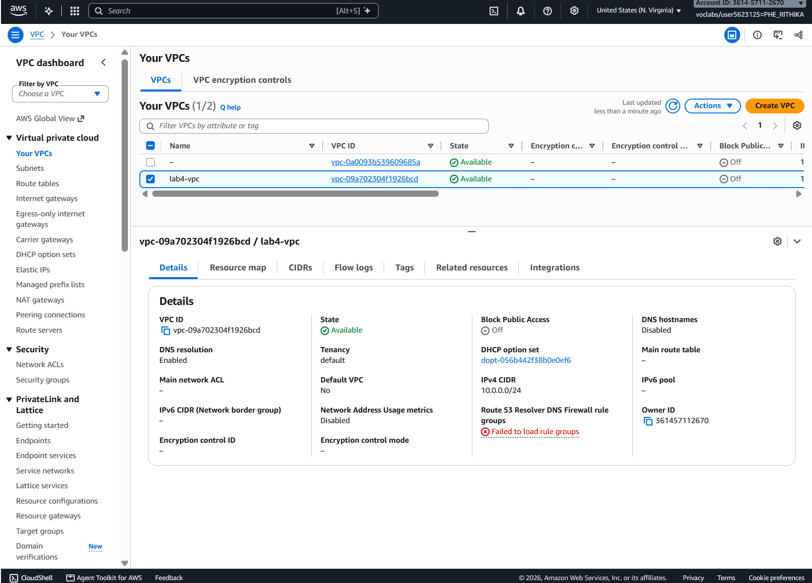

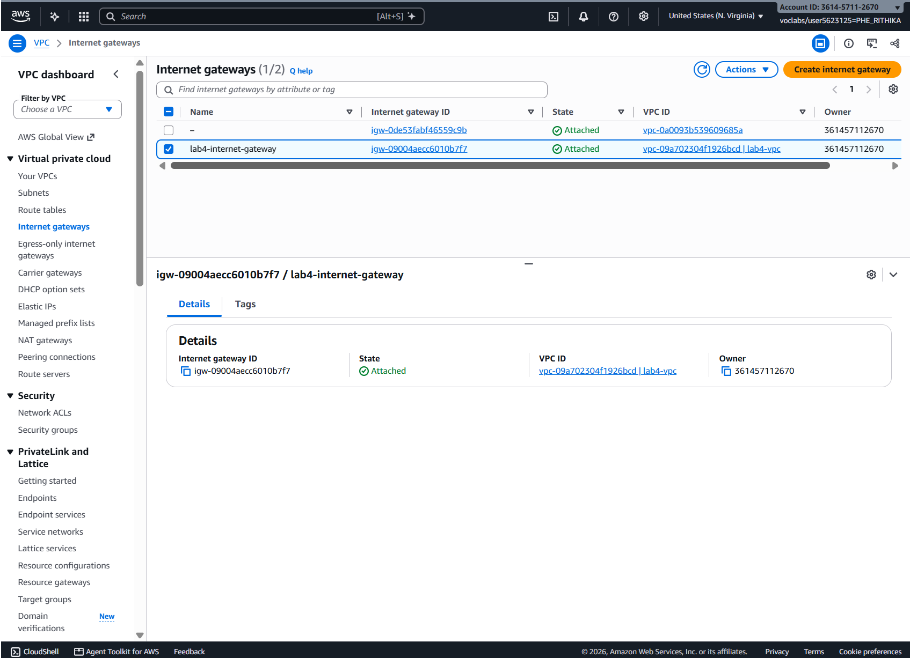

## Public subnet

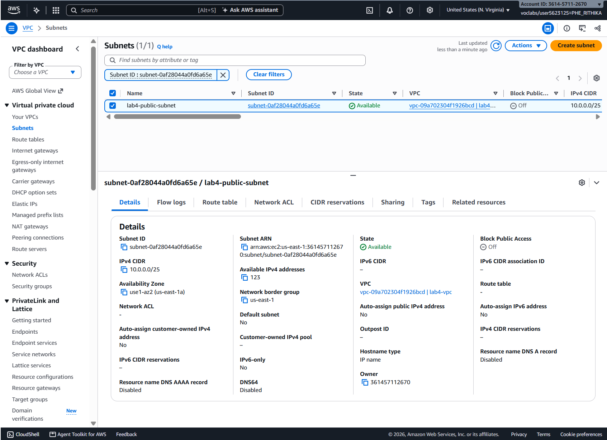

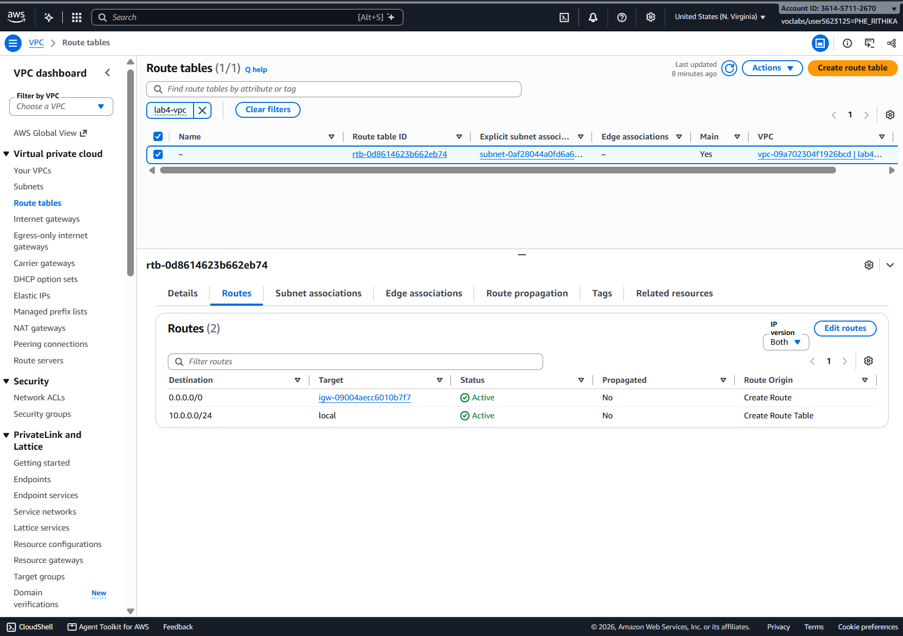

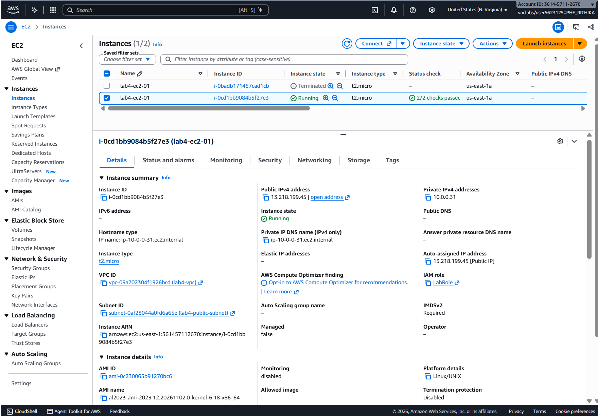

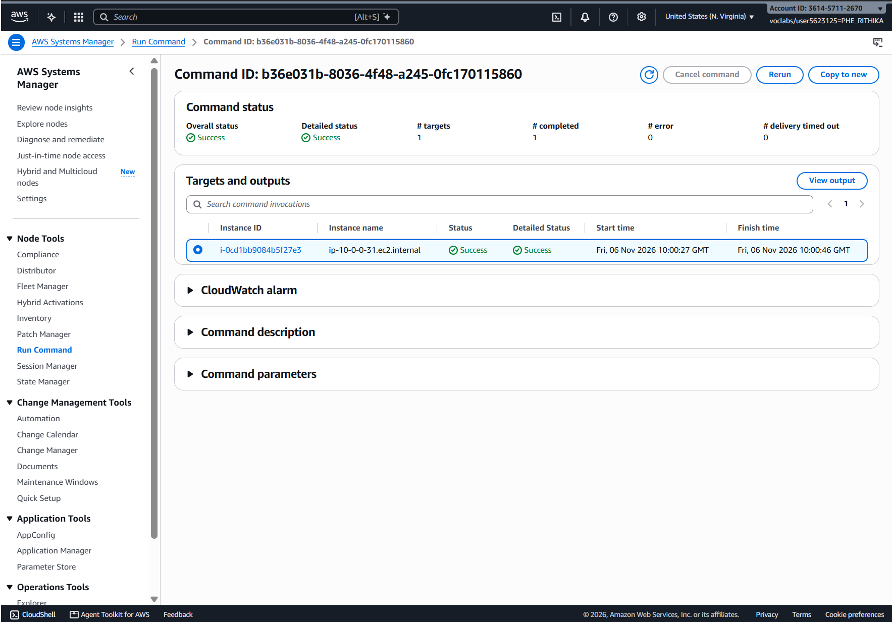

## Private subnet

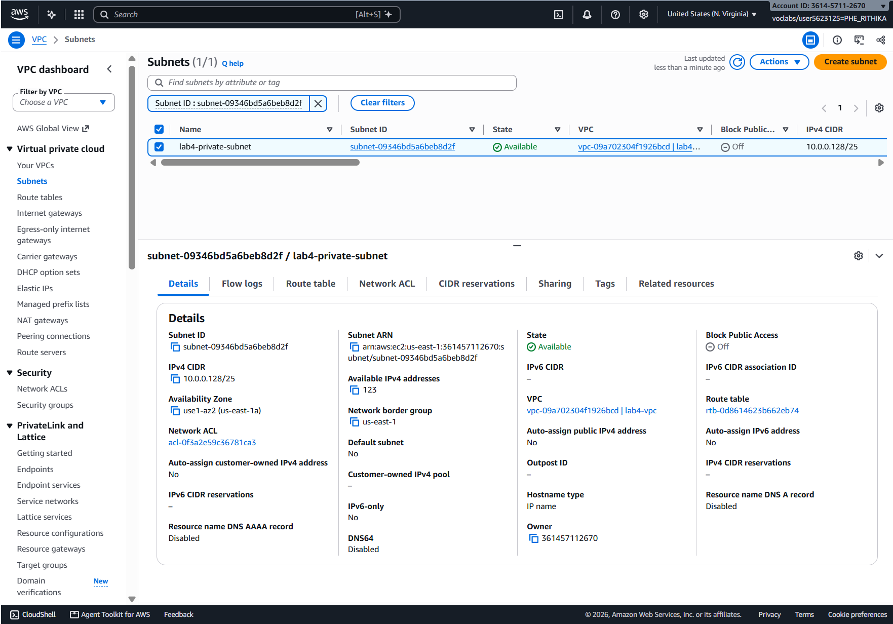

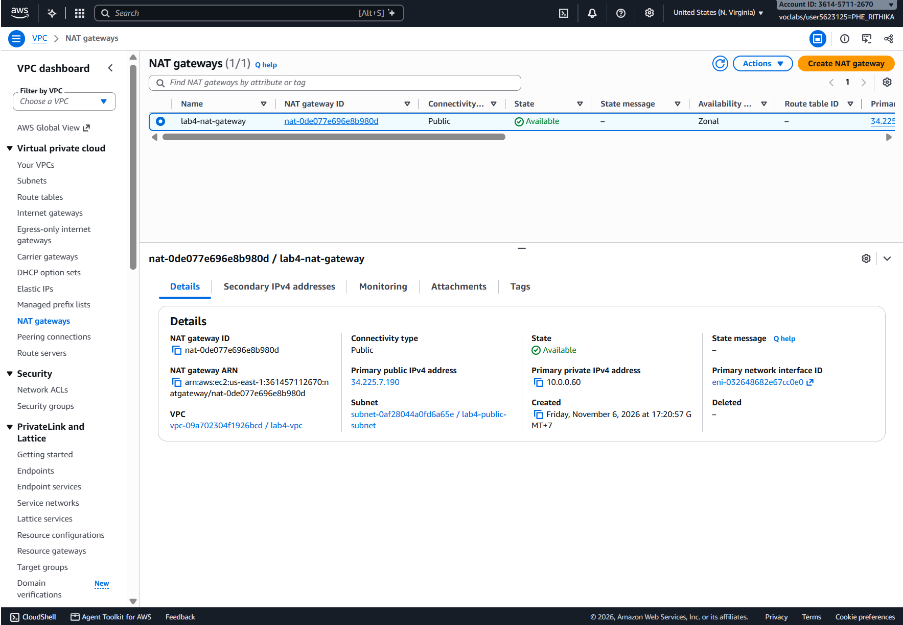

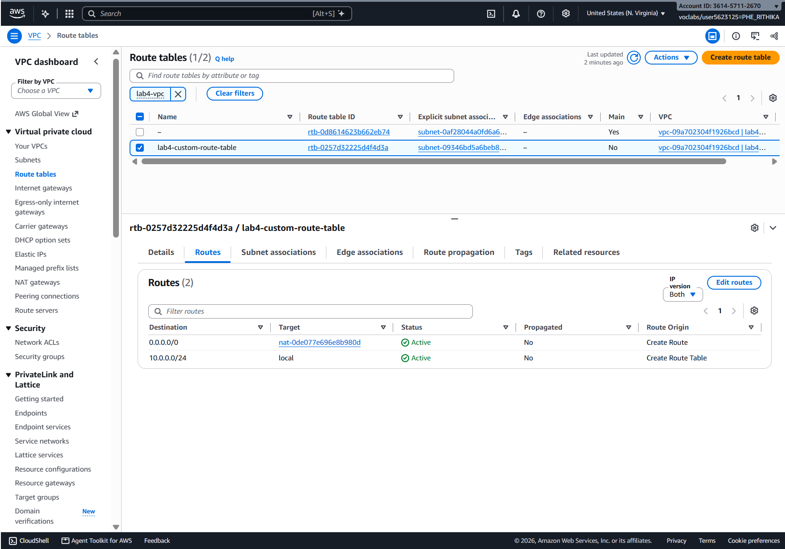

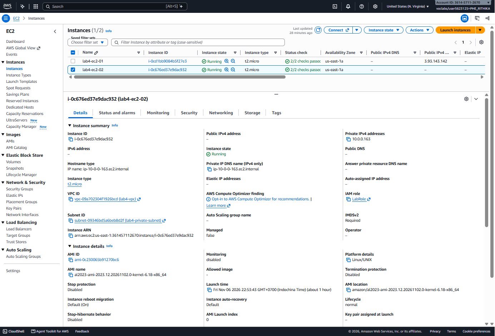

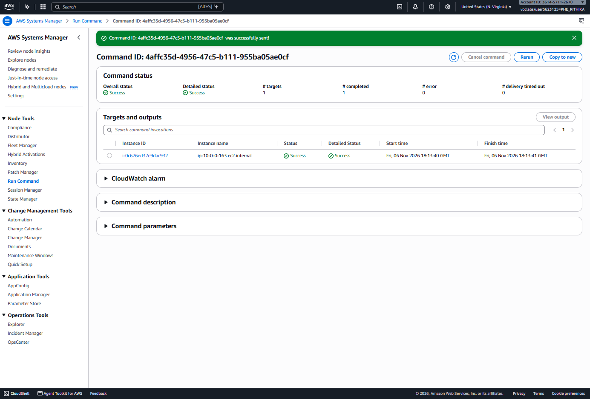

---

## Questions

1. The VPC is `10.0.0.0/24` and the subnets are `10.0.0.0/25` and `10.0.0.128/25`. How many IP addresses does each block contain, and why do the two subnets not overlap?

   A /24 has 2^(32-24) = 256 addresses. A /25 has 2^(32-25) = 128 addresses (AWS reserves 5 in each subnet, so 123 are usable). `10.0.0.0/25` covers `10.0.0.0`–`10.0.0.127` and `10.0.0.128/25` covers `10.0.0.128`–`10.0.0.255`. The ranges do not share any address, and together they fill the whole VPC range exactly.

2. Both subnets are in the same VPC. What exactly makes `lab4-public-subnet` public and `lab4-private-subnet` private?

   The route table. The public subnet's route table has a route `0.0.0.0/0` → internet gateway, so its instances (which also have public IPs) can send and receive traffic directly with the internet. The private subnet's route table sends `0.0.0.0/0` to the NAT gateway and has no route to the internet gateway, so nothing from the internet can reach it directly.

3. Why is the NAT gateway placed in the **public** subnet and not in the private one?

   The NAT gateway must itself reach the internet through the internet gateway, and it needs an Elastic IP. That only works from a subnet whose route table points to the internet gateway. In the private subnet it would have no path out, so the private instance's traffic would never leave the VPC.

4. `lab4-ec2-02` has no public IP address. Can someone on the internet open a connection to it? Can it download updates? Explain both answers.

   No inbound: it has no public IP, the internet gateway has no route to it, and its security group has no inbound rules. Yes outbound: its traffic goes to the NAT gateway, which translates the private address to its Elastic IP and forwards through the internet gateway. The NAT gateway only allows return traffic for connections that the instance started, so downloading updates works.

5. You tested internet access with Systems Manager instead of SSH. Why did the instances need `LabInstanceProfile` for this?

   The SSM Agent on the instance must authenticate to the Systems Manager service to register as a managed node and receive commands. The instance profile gives the instance the IAM role (`LabRole`) with those permissions. Without it, the instance would not appear in the Run Command target list. No SSH key or inbound port is needed because the agent connects outbound.

## Problems and how I solved them (optional)

- When I first added the route, I typed `lab4-internet-gateway` in the Destination box. The console showed "A valid CIDR block or a prefix list has to be specified." I put `0.0.0.0/0` in Destination and chose Internet Gateway → `lab4-internet-gateway` as the Target, and the route saved.
- Amazon Linux 2 was not offered, so I used Amazon Linux 2023. `sudo yum update -y` still works on it.

## AI note (optional)

An AI tool suggested that the NAT gateway belongs in the public subnet. I checked this against the lab instructions and by confirming that the public subnet's route table points to the internet gateway.

## Clean up

- [x] Instances terminated.
- [x] NAT gateway deleted and its Elastic IP released.
- [x] Internet gateway detached and deleted.
- [x] `lab4-vpc` deleted.

